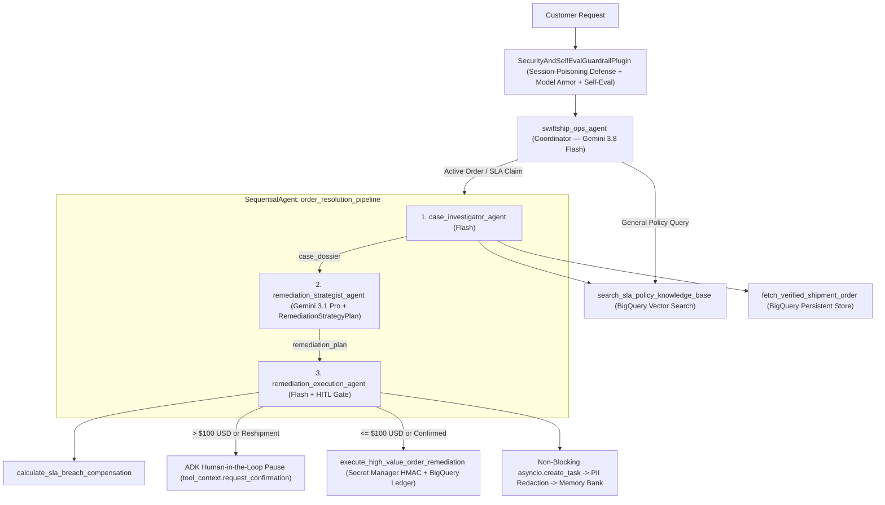

# SwiftShip Operations & SLA Resolution Agent (`swiftship-ops-agent`)

An enterprise multi-agent logistics operations and SLA dispute resolution system built with the **Google Agent Development Kit (ADK Python)**, **Vertex AI / Gemini**, **BigQuery Vector Search**, **OpenTelemetry / Cloud Trace**, **Cloud DLP**, **Model Armor**, **Secret Manager**, **Terraform**, and **`agents-cli`**.

---

## Problem & Solution

Manual enterprise logistics resolution requires support specialists to cross-reference shipment scan telemetry, thermal sensor logs, multi-tier SLA contracts, and monetary approval matrices — leading to slow turnaround times, inconsistent payouts, and compliance exposure.

`swiftship-ops-agent` automates end-to-end shipment triage and SLA remediation while enforcing strict monetary, security, and privacy controls:



---

## AgentOps Architecture & Code Evidence Matrix

| Category | Capability | Implementation File(s) |
|---|---|---|
| **1. Tool & Interface Design** | **Comprehensive Tool Docstrings** | `app/tools/order_tools.py`, `app/tools/policy_tools.py`, `app/tools/remediation_tools.py` — Full Google-style `Args` & `Returns` docstrings on every tool. |
| | **Descriptive Naming** | Verb-noun domain names: `fetch_verified_shipment_order`, `search_sla_policy_knowledge_base`, `calculate_sla_breach_compensation`, `execute_high_value_order_remediation`. |
| | **Explicit JSON Schemas** | `app/schemas.py` — Strict Pydantic v2 `StrictSchema` (`extra="forbid"`, regex/bound constraints) for all tool inputs/outputs and `RemediationStrategyPlan` (`output_schema`). |
| | **Guided Error Handling** | `app/schemas.py` (`GuidedToolError`) & `app/tools/*.py` — Returns structured `error_code` and `recovery_instructions` guiding LLM self-correction without crashing. |
| **2. Context & Memory** | **Robust System Instructions** | `app/prompts.py` — Explicit XML-structured `SWIFTSHIP_AGENT_CONSTITUTION` defining persona, four SLA tiers, $100 authority cap, privacy rules, and refusal policy. |
| | **History Compaction** | `app/agent.py` & `app/memory.py` — ADK `EventsCompactionConfig` (`token_threshold=24000`, `SwiftShipEventSummarizer`) + `ContextCacheConfig(min_tokens=2048)`. |
| | **Persistent Session State** | `app/persistence.py` & `app/app_utils/services.py` — Persistent BigQuery order & `text-embedding-005` vector policy search (`ML.DISTANCE`) + `VertexAiSessionService` / `DatabaseSessionService` / `VertexAiMemoryBankService` (`PreloadMemoryTool`). |
| | **Async Memory Operations** | `app/memory.py` — `schedule_async_memory_consolidation` dispatches PII-scrubbed Memory Bank consolidation via non-blocking `asyncio.create_task(...)`. |
| **3. Orchestration & Logic** | **Multi-Agent Patterns** | `app/agent.py` — Coordinator (`swiftship_ops_agent`) delegating to a 3-stage `SequentialAgent` (`order_resolution_pipeline`). |
| | **Strategic Model Routing** | `app/model_router.py` — Routes low-latency operational agents to `gemini-3.8-flash` and complex SLA planning (`remediation_strategist_agent`) to `gemini-3.1-pro-preview`. |
| | **Guardrails & Policy Plugins** | `app/guardrails.py` — Runner-wide `SecurityAndSelfEvalGuardrailPlugin(BasePlugin)` with session-poisoning protection, Google Cloud Model Armor API support, tool bounds checks, output self-evaluation, plus `ReflectAndRetryToolPlugin`. |
| | **Human-in-the-Loop Hooks** | `app/tools/remediation_tools.py` & `app/agent.py` — `ResumabilityConfig(is_resumable=True)` + `tool_context.request_confirmation(...)` halting disbursements > $100.00 USD or replacement reshipments (`SLA-GOV-09`). |
| **4. Observability & Tracing** | **Structured JSON Logging** | `app/observability/logging_config.py` — `CloudStructuredJsonFormatter` (`python-json-logger`) with Cloud Trace correlation; `print()` banned across `app/` via Ruff `T20`. |
| | **Intent vs. Outcome Capture** | `app/observability/audit_plugin.py` — `IntentOutcomeAuditPlugin` logs correlated `agent_action_intent` (`before_tool`) and `agent_action_outcome` (`after_tool` / `on_tool_error`). |
| | **Distributed Tracing** | `app/observability/tracing.py` — OpenTelemetry `TracerProvider`, `CloudTraceSpanExporter`, and `@traced_operation` linking request, agent, LLM, tool, and memory spans. |
| | **PII Redaction** | `app/observability/pii_redactor.py` — `PiiRedactionService` combining Google Cloud Sensitive Data Protection (`google-cloud-dlp`) and deterministic regex scrubbing across logs and memory writes. |
| **5. Infrastructure & CI/CD** | **Automated Evaluation Suites** | `tests/eval/eval_config.yaml`, `tests/eval/datasets/basic-dataset.json`, `tests/eval/datasets/holdout-safety-dataset.json`, and `tests/unit/test_agentops_rubric.py`. |
| | **Infrastructure as Code** | `deployment/terraform/single-project/*.tf` (Agent Runtime, BigQuery dataset/tables, Secret Manager, DLP/Trace/Model Armor APIs & IAM) + `.github/workflows/*.yaml` CI/CD. |
| | **Secure Secret Management** | `app/secrets.py` — `SecretManagerProvider` (`google-cloud-secret-manager`) with TTL caching and zero hardcoded API keys. |

---

## Quickstart with `agents-cli` & `uv`

### 1. Install Dependencies
```bash
cp .env.example .env
# Set GOOGLE_CLOUD_PROJECT=<your-gcp-project-id> in .env
uv sync --all-extras --dev
```

### 2. Provision Persistent BigQuery Order & Vector Policy Store
```bash
uv run python scripts/provision_bigquery_store.py
```

### 3. Smoke Test & Interactive Playground (`agents-cli`)
```bash
# Inspect project configuration
agents-cli info

# Run a single prompt from the terminal
agents-cli run "My Express 48h shipment ORD-10042 arrived 48 hours late. What credit do I qualify for?"

# Launch the interactive ADK Web Playground (supports HITL approval cards)
agents-cli playground
```

### 4. Lint, Deterministic Unit Tests, and Golden Evaluations
```bash
# Static analysis (ruff including T20 no-print, ruff format, codespell, ty)
agents-cli lint

# Deterministic unit & contract tests
uv run pytest tests/unit

# End-to-end LLM-as-judge & policy compliance evaluation against golden datasets
agents-cli eval run --dataset tests/eval/datasets/basic-dataset.json --config tests/eval/eval_config.yaml
agents-cli eval run --dataset tests/eval/datasets/holdout-safety-dataset.json --config tests/eval/eval_config.yaml
```

### 5. Provision Infrastructure (Terraform) & Deploy to Agent Runtime
```bash
# Provision Terraform-managed Agent Runtime, BigQuery, Secret Manager, Telemetry & IAM
agents-cli infra single-project --apply --project "$GOOGLE_CLOUD_PROJECT"

# Deploy the multi-agent application to Agent Runtime
agents-cli deploy
```
